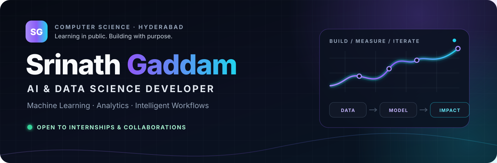

<p align="center">
  
</p>

<p align="center">
  <a href="https://portfolio-website-srinath22.vercel.app">
    
  </a>
  <a href="https://linkedin.com/in/srinathgaddam-997123331">
    
  </a>
  <a href="mailto:sre.srinath1378@gmail.com">
    
  </a>
  
</p>

## I turn data into products people can use.

I'm a **Computer Science undergraduate in Hyderabad** working across data science, machine learning, analytics, and AI-powered workflows. My sweet spot is the complete journey:

```text
understand the problem → shape the data → build the model → measure honestly → make it usable
```

- 🔭 **Building:** end-to-end ML applications, analytics pipelines, and intelligent workflows.
- 🎓 **Studying:** BSc (Honours) Computer Science, 2024–2027.
- ⚡ **Exploring:** ML engineering, AI agents, prompt engineering, and n8n automation.
- 🏎️ **Inspired by:** Formula 1 telemetry—where tiny data advantages become real-world performance.
- 🎯 **Open to:** internships and collaborations in Data Science, Data Analytics, and AI Development.

## ⚡ Featured build

### 🎫 [TicketTriage — Support Ticket Classification & Routing](https://github.com/srinath698/Automated-ticket-classifier)

An end-to-end NLP application that classifies customer-support tickets, recommends department routing, and provides optional grounded AI explanations—without letting the explanation layer override the authoritative ML prediction.

| Held-out accuracy | Macro ROC-AUC | Backend tests |
|:---:|:---:|:---:|
| **95.18%** | **0.9980** | **11 passed** |

**Under the hood:** TF-IDF + Logistic Regression · scikit-learn · FastAPI · React · Vite · Tailwind CSS · OpenRouter

[**Explore the code →**](https://github.com/srinath698/Automated-ticket-classifier) · [**Open the live app →**](https://automated-ticket-classifier.vercel.app)

## 🚀 More selected work

- **[Zepto Analytics Pipeline](https://github.com/srinath698/zepto-analytics-pipeline)**  
  SQL-to-insights analysis of **3,731 product-catalog rows**, covering pricing, discounts, inventory, stockout risk, visualization, and stakeholder-ready business findings.  
  `SQL` `PostgreSQL` `Python` `Pandas` `Statistics` `Tableau`

- **[Adidas Sales Analytics Dashboard](https://github.com/srinath698/adidas-sales-dashboard-tableau)**  
  Interactive Tableau dashboard for sales, profit, margin, retailer, regional, and product-category analysis.  
  `Tableau` `Excel` `Business Intelligence` `Data Storytelling`

- **[ML Engineering Journey](https://github.com/srinath698/ML-engineering-journey)**  
  A public learning log focused on understanding ML deeply—from preprocessing and supervised learning to evaluation and complete scikit-learn pipelines.  
  `Machine Learning` `Scikit-learn` `Decision Trees` `Model Evaluation`

- **[Portfolio Website](https://github.com/srinath698/portfolio-website)**  
  A responsive personal portfolio with project showcases, certifications, experience, and custom interaction design.  
  `React` `Vite` `JavaScript` `CSS`

## 🧰 Technical toolbox

**Data & Machine Learning**


**Applications & AI**


**Analytics & Workflow**


## 🧠 How I approach the work

- **Start with the decision, not the model.** The analysis should help someone act.
- **Measure on data the model hasn't memorized.** Honest evaluation beats impressive-looking demos.
- **Treat the interface and documentation as part of the product.** A useful model deserves a usable experience.
- **Learn in public.** Notes, mistakes, iterations, and breakthroughs are all worth sharing.

## 🎓 Learning & credentials

- **AWS Artificial Intelligence Practitioner Learning Plan** — completed July 2026.
- **AI Fluency for Students** — Anthropic.
- **Data Analytics Job Simulation** — Deloitte.
- **Agents & Workflows** — OpenAI Academy.

[Browse my certifications and learning notes →](https://github.com/srinath698/certifications)

## 📊 GitHub at a glance

<p align="center">
  <picture>
    <source media="(prefers-color-scheme: dark)" srcset="https://github-readme-stats.vercel.app/api?username=srinath698&show_icons=true&hide_border=true&bg_color=00000000&title_color=A78BFA&icon_color=22D3EE&text_color=CBD5E1&ring_color=8B5CF6" />
    <source media="(prefers-color-scheme: light)" srcset="https://github-readme-stats.vercel.app/api?username=srinath698&show_icons=true&hide_border=true&bg_color=00000000&title_color=6D28D9&icon_color=0891B2&text_color=334155&ring_color=7C3AED" />
    
  </picture>
  <picture>
    <source media="(prefers-color-scheme: dark)" srcset="https://github-readme-stats.vercel.app/api/top-langs/?username=srinath698&layout=compact&hide_border=true&bg_color=00000000&title_color=A78BFA&text_color=CBD5E1" />
    <source media="(prefers-color-scheme: light)" srcset="https://github-readme-stats.vercel.app/api/top-langs/?username=srinath698&layout=compact&hide_border=true&bg_color=00000000&title_color=6D28D9&text_color=334155" />
    
  </picture>
</p>

## 🤝 Let's build something useful

If you're working on a data product, ML application, analytics problem, or AI workflow—or you have an internship opportunity—I'd be glad to connect.

<p align="center">
  <a href="mailto:sre.srinath1378@gmail.com"><strong>Email me</strong></a> ·
  <a href="https://linkedin.com/in/srinathgaddam-997123331"><strong>LinkedIn</strong></a> ·
  <a href="https://portfolio-website-srinath22.vercel.app"><strong>Portfolio</strong></a>
</p>

<p align="center">
  <strong>Understand the data. Respect the metrics. Ship the solution.</strong>
</p>
